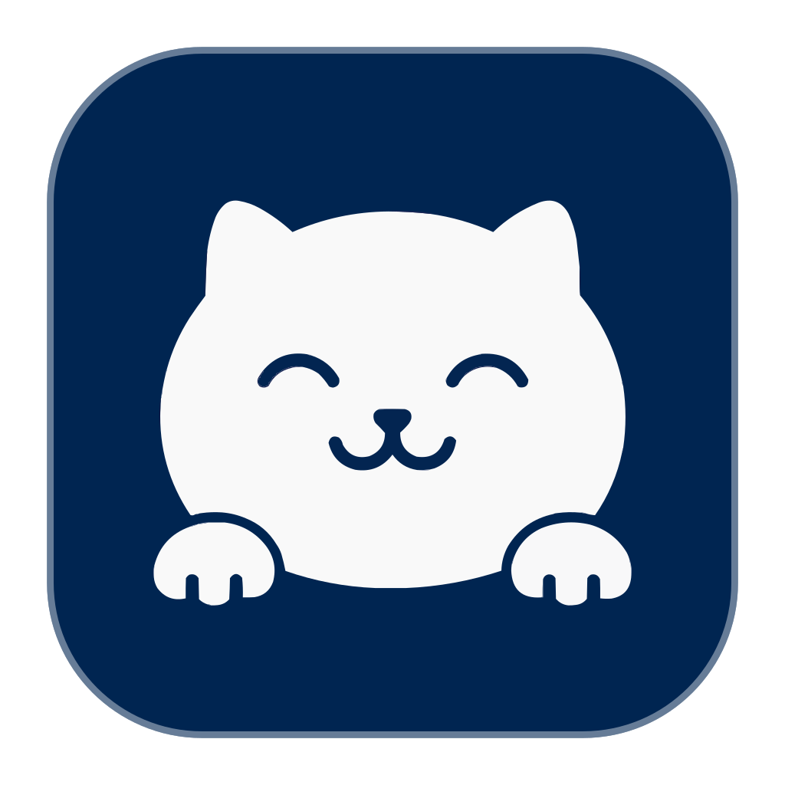
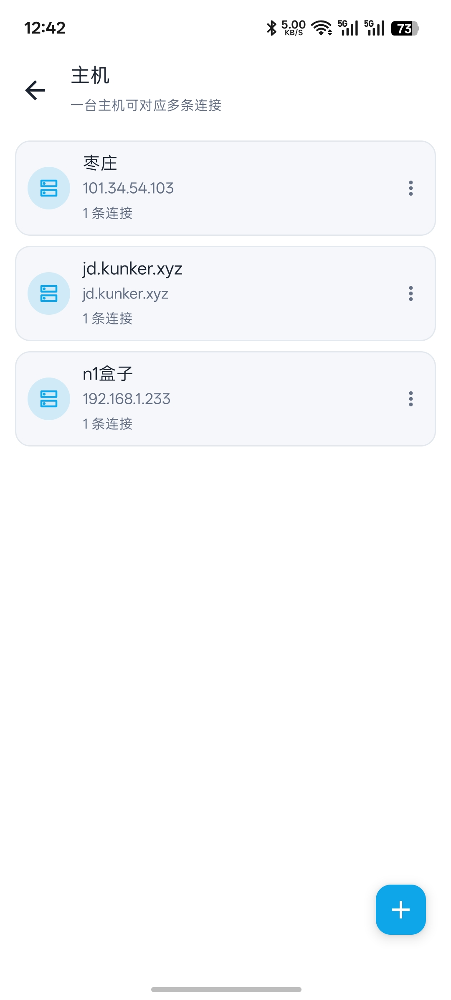
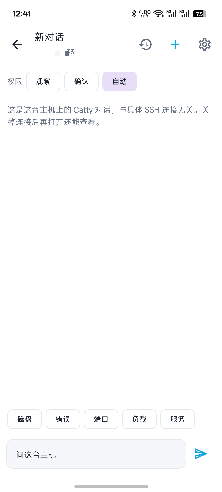
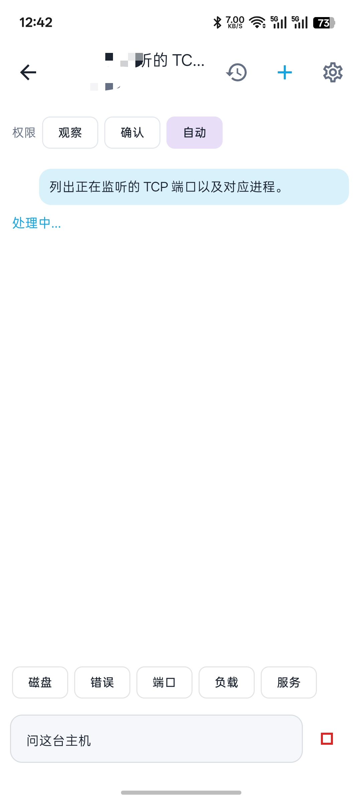
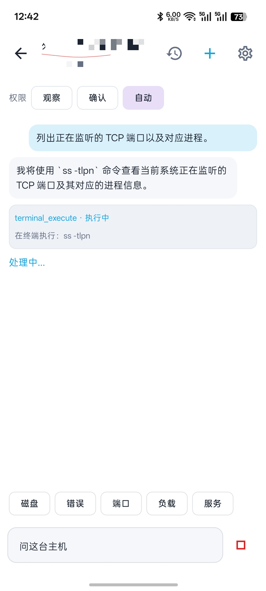
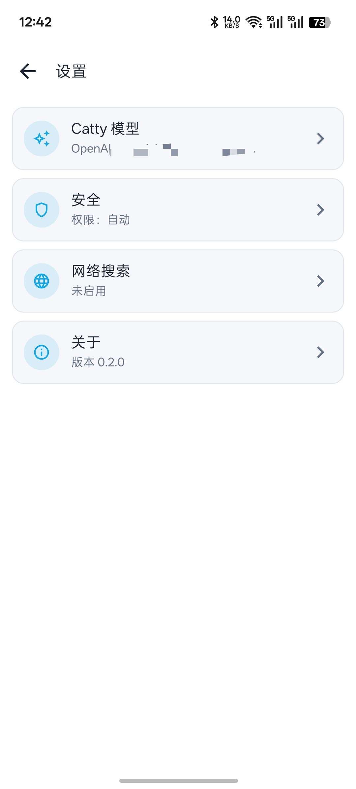

<p align="center">
  
</p>

<h1 align="center">Netcatty</h1>

<p align="center">
  <strong>Native Android SSH client</strong><br/>
  Encrypted vault · live sessions · terminal / SFTP · tunnels · Catty ops
</p>

<p align="center">
  
  &nbsp;
  
  &nbsp;
  <a href="LICENSE"></a>
</p>

<p align="center">
  <a href="./README.md">English</a> · <a href="./README.zh-CN.md">简体中文</a> · <a href="./README.zh-TW.md">繁體中文</a> · <a href="./README.ja-JP.md">日本語</a>
</p>

---

Netcatty for phones: a native Kotlin / Jetpack Compose app, not an Electron wrap. Chinese light UI. One host can keep several SSH connections. Catty chats are bound to the host, so history is still there after you disconnect.

## Screenshots

<p align="center">
  
  &nbsp;
  
  &nbsp;
  
</p>

<p align="center">
  
  &nbsp;
  
</p>

| Screen | What it shows |
| --- | --- |
| Host list | One host can have many connections |
| New Catty chat | Chat is bound to the host; permission is Observer / Confirm / Auto |
| Catty running | Progress while a question is handled; Send becomes Stop |
| Command step | Commands run in the interactive shell; steps also appear in the notification |
| Settings | Catty model, command safety, web search |

## Features

### Hosts and connections

- Encrypted vault: label, host, port, user, password or private key, notes
- Home shows live sessions only; tap **+** to pick a host and connect
- Connection list shows latency, CPU / memory / disk, and whether Catty is running
- Several SSH sessions can stay open on the same host

### Terminal

- Interactive SSH terminal (xterm.js)
- Pinch-zoom with a sane font range, blinking cursor, long-press select and copy
- When the cwd has docker-compose, manage containers from the terminal (start / stop / restart / pause / logs / shell)

### SFTP

- Browse the whole tree, including `/`
- Built-in editor with highlight and format for yml, conf, and similar files
- Jump the current folder into the terminal

### Tunnels

- Local, remote, and dynamic SOCKS5 forwards
- Optional auto-start; the keep-alive notification can open the tunnel list

### Catty ops

- Chat is bound to the host, not to one SSH connection
- Permission modes: Observer, Confirm, Auto
- Commands run in the interactive shell with visible steps
- OpenAI-compatible models, command blocklist, optional web search
- Notification shows execution progress; tap it to return to Catty or the terminal

## Usage

1. Open **Hosts** and add a machine (password or private key).
2. On the connection list, tap **+** and connect.
3. From the terminal, open SFTP, Docker, tunnels, or Catty.
4. First Catty run: open **Settings**, set an OpenAI-compatible API base and key, then refresh the model list if needed.
5. Updates come from GitHub Releases. The app checks on launch; you can also check from **Settings → About**.

Destructive commands stay blocked by the safety rules. With a live session or tunnel, a keep-alive notification stays in the shade.

## Build

Needs JDK 17+ and Android SDK 35. Minimum Android 8.0 (API 26).

```powershell
$env:JAVA_HOME="C:\Program Files\Eclipse Adoptium\jdk-21.0.12.101-hotspot"
$env:ANDROID_HOME="$env:LOCALAPPDATA\Android\Sdk"
cd android
.\gradlew.bat assembleDebug
```

The APK is `android/app/build/outputs/apk/debug/app-debug.apk`.

```powershell
adb install -r android\app\build\outputs\apk\debug\app-debug.apk
```

More Android project notes: [`android/README.md`](android/README.md).

## Tech stack

| Area | Stack |
| --- | --- |
| Language / UI | Kotlin, Jetpack Compose, Material 3 |
| SSH / SFTP | sshj 0.39, BouncyCastle |
| Terminal | WebView + xterm.js |
| Vault | EncryptedFile (AES-256-GCM) |
| Catty | OpenAI-compatible API, OkHttp |
| Package / version | `app.netcatty` · 0.2.1 |

## Relation to the desktop app

Desktop Netcatty is an Electron workspace: [binaricat/Netcatty](https://github.com/binaricat/Netcatty). This app is a separate native Android client, rebuilt for a phone and shipped with Catty ops.

## License

GPL-3.0. See [LICENSE](LICENSE).
